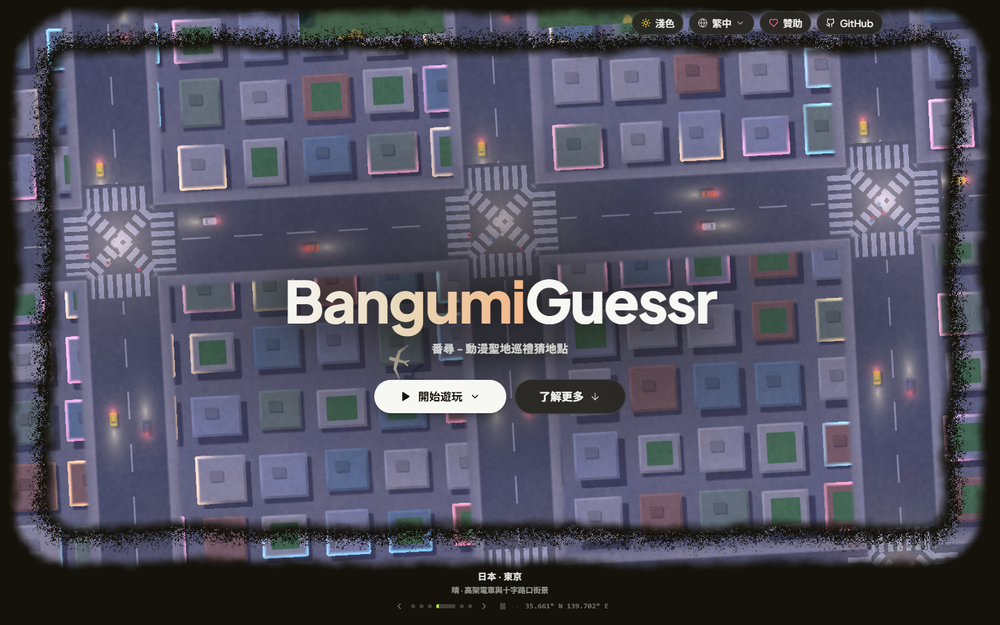
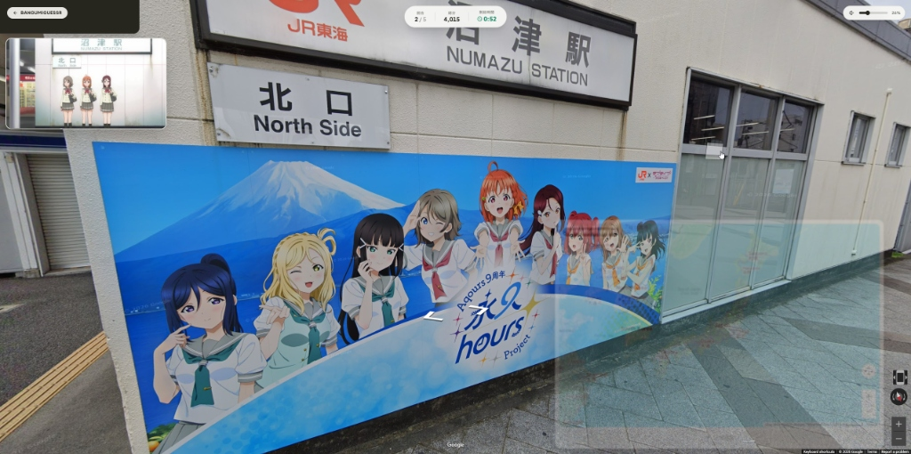

# BangumiGuessr

**Anime Pilgrimage GeoGuessr in Japan & Worldwide · 动漫圣地巡礼猜地点**

Explore real-life anime pilgrimage spots across Japan and iconic overseas locations in 360° Google Street View, match the floating anime scene reference, and drop your pin on the map — solo or live with friends, no account required.

### **[▶ Play Now — bangumiguessr.onely1.workers.dev](https://bangumiguessr.onely1.workers.dev)**

---

## Preview

---

## What's Inside

- **198 Curated Anime Franchises & 3,127 Spots**: 275 TV anime, theatrical films, and OVAs — visually reviewed, spatially de-clustered, and verified for Google Street View coverage.
- **All Japan (Easy) Mode**: A dedicated beginner-friendly mode featuring **50 iconic, widely recognizable anime** (1,127 Japan spots — *Your Name*, *Weathering With You*, *Bocchi the Rock!*, *Yuru Camp*, *Jujutsu Kaisen*, *Haikyu!!*, *Slam Dunk*, *Steins;Gate*, *Chainsaw Man*, *K-ON!*, and more) with franchise-balanced rounds.
- **11 Playable Modes & Regions**: All Japan, All Japan (Easy), 8 Japan Regions (Tokyo, Greater Kanto, Kansai, Chubu, Hokkaido, Tohoku, Chugoku & Shikoku, Kyushu & Okinawa), plus **Outside Japan** (78 overseas pilgrimage spots across 20 franchises in Europe, Asia, North America & Australia).
- **Solo & Zero-Login Multiplayer**: Create a room, copy the invite link, pick a nickname, and race friends live with automatic 10-second round transitions.
- **Authentic GeoGuessr Scoring**: Per-region exponential distance curve with a golden **5,000** full score within 50 meters.
- **4 Languages, Themes & BGM**: Auto-detects browser language (`简中`, `繁中`, `English`, `日本語`), with Warm Dark (default) and Light themes plus toggleable background music across desktop and mobile.

---

## Credits & Attribution

BangumiGuessr would not exist without the anime pilgrimage community:

- **[Anitabi (动画巡礼 / 神奇海螺)](https://www.anitabi.cn/)** — Anime pilgrimage location coordinates and scene references are sourced from Anitabi under the **[CC BY-NC-SA 4.0](https://creativecommons.org/licenses/by-nc-sa/4.0/)** license. Huge thanks to the Anitabi team and every community contributor who documents real-life anime locations worldwide!
- **[Bangumi (番组计划)](https://bgm.tv/)** — Anime metadata and catalog information.
- **Google Maps Platform** — Interactive Street View & map rendering.

*(All anime screenshots belong to their respective copyright holders and are referenced strictly for non-commercial fan appreciation and pilgrimage exploration.)*

---

## Buy Me a Coffee

BangumiGuessr is completely free to play with no ads and no login. If you enjoy the game and would like to buy me a coffee to support ongoing spot curation and maintenance, you can click below *(also available via the **Sponsor** button on the website)*:

☕ WeChat Pay (微信支付)

 

☕ PayMe (HSBC Hong Kong)

 

☕ HK FPS (香港轉數快)

 

- **FPS ID (轉數快識別碼)**: `111020509`

---

## Feedback & Anime Spot Requests

Want to suggest an anime to add, report a broken Street View spot, or share feedback? Feel free to open a **[GitHub Issue](https://github.com/Uione/BangumiGuessr/issues)**!
